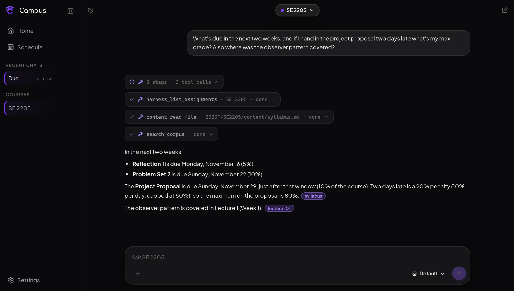

<p align="center">
  
</p>

# Campus

Campus syncs Brightspace into local SQLite and files so you can search, chat, and verify answers against your actual course material.


<p align="center">
  
  <br />
  <sub>Example conversation.</sub>
</p>

The hard part was exact-phrase search: a short verbatim line scored 0.34 cosine against a 0.48 cutoff and buried the right slide, so `sync/search.py` keeps a SQLite `instr()` lexical pre-filter that promotes those hits before any reranking.

Python 3.12, FastAPI, SQLite, React, TypeScript, Docker. Solo project.

I use it every day for my own courses. 423 backend tests across 36 files and 55 web tests across 5 files run in CI on every push.

## Quickstart

```bash
git clone https://github.com/HasNate618/Campus && cd Campus
docker compose up --build
# open http://localhost:8087
```

There is no hosted live demo. This starts Campus in demo mode with a made-up sample course, so you can browse and search without a Brightspace account. To turn on chat, set `OPENAI_ENDPOINT` and `OPENAI_MODEL` in `docker-compose.yml` (plus `OPENAI_API_KEY` if your endpoint needs one); any OpenAI-compatible `/v1` endpoint with tool calling works. To sync your own courses, see [Configuration](docs/CONFIGURATION.md). Without Docker, or on Nix, see [Local setup](#local-setup-without-docker).

## What it does

I built Campus because my course material was scattered across six Brightspace pages, with files buried four clicks deep and due dates that lived in a dropbox and also in a line of the syllabus PDF. It syncs every course into SQLite and a local file store, skips any file whose sha256 hasn't changed, and gives a 20-tool agent structured access to that store instead of pasting files into the prompt, so each answer links to the file and PDF page it came from. The agent can also edit my notes and due dates, every one of those writes is logged with the before and after state, and the whole thing runs on any OpenAI-compatible endpoint, whether that's a model on my own hardware or a cheap hosted one.

- **Deterministic LMS sync:** D2L REST plus Playwright and MFA auth pulls the content tree, module landing pages, files, dropbox assignments, announcements and the syllabus. Change detection runs on sha256, so an unchanged file is never downloaded twice and nothing is scraped in the background.
- **Course-scoped agent:** 20 built-in tools over your own data, covering assignments, announcements and facts, paginated file reads, grep, corpus search, audited mutations, recall quizzes and file edits, with `terminal_run` available only when you turn it on. The web app tells the agent what you currently have open, down to the PDF page, so "explain this" resolves against the real view.
- **Search that starts lexical:** the default ranker needs no extra model and boosts exact phrases so a verbatim hit lands first. Setting `embed_model` and `rerank_model` adds embeddings and reranking on top, and the lexical boost still promotes verbatim hits that embed badly.
- **Demo mode:** `docker compose up` seeds one clearly fictional course and shows a banner saying so, so a stranger can browse, read and search with no Brightspace account and no model endpoint.
- **Portable by construction:** every URL, path and credential is config-driven, and the repo ships with zero personal configuration. Point it at any Brightspace instance and any OpenAI-compatible endpoint, or at neither.

## How it works

A sync run uses Playwright (including MFA) and the D2L REST API to pull the content tree, files, dropbox assignments, announcements and the syllabus into SQLite and a local file store. Change detection runs on sha256, so an unchanged file is never downloaded twice and nothing is scraped in the background.

The store is the source of truth: 20 tables in `schema.sql`, the files on disk, and an ephemeral search index. Search starts lexical (a SQLite `instr()` pre-filter and snippet windowing). Embeddings and reranking are added only when `embed_model` and `rerank_model` are set, and the lexical boost still promotes verbatim hits that embed badly.

When you ask a question, the web app sends only the IDs and position of the file or assignment you have open. The server resolves the path, title, deadline, status and PDF page from SQLite, so the model never trusts client-provided source details. The agent does not receive a course dump. It uses tools to query the store (`harness_*` for dates and deadlines, `content_read_file`, `content_grep` and `search_corpus` for prose). Those tools register sources in `agent/citations.py`, which become `[cite:N]` chips you can open to the file and page. If the answer is not in the synced data, the system prompt tells the model to say so.

Writes (extending a due date, saving a fact, editing a file) go through tools that log before and after JSON to `audit_log`. Facts are superseded by flipping `is_active` to 0 and inserting a new row, never deleted in place. I chose SQLite WAL over Postgres so a fresh clone and a Docker demo stay portable, at the cost of lower throughput, which is fine at this scale. Sync is something you trigger, not a background scrape, because a background job would fight MFA.

```text
Brightspace / D2L
  -> sync/ (D2L REST + Playwright/MFA, sha256 change detection)
  -> SQLite (20 tables in schema.sql + ephemeral search index) + files on disk
  -> agent/ (context builder, 20 built-ins + MCP, audited writes, citations)
  -> FastAPI + React PWA
  -> Browser
```

The system prompt is rebuilt every turn from live state: current time, active term, course scope, upcoming events, and the course memory card. Quiz grading is blind: the grading model only sees the answer key and what you wrote, not the question text, so it cannot be nice or leak the lesson. Recently quizzed facts are skipped for 7 days so chat history does not give away the answer.

Assignment, exam and event feeds are deduplicated by course, local calendar day and normalized title tokens, so the same deadline is shown once without merging distinct items such as Lab 1 and Lab 2. Markdown from chat, digests, workspace files and synced content is sanitized before rendering, and Mermaid runs in strict security mode. Treat the UI as a viewer for trusted course data, not as a sandbox for untrusted HTML.

More detail lives in [`docs/DESIGN.md`](docs/DESIGN.md) and [`docs/DATA_MODEL.md`](docs/DATA_MODEL.md).

## What didn't work

I assumed embeddings would just work, and then a short exact phrase failed at 0.34 cosine against a 0.48 cutoff and buried the right slide. Adding a SQLite `instr()` lexical pre-filter felt almost too simple, but it fixed the exact questions a student actually asks, and windowing the snippet around that match kept the answer text from getting cut.

I also left background scraping out on purpose. A sync you trigger is slower than a daemon, but it does not fight the hourly MFA push.

## Limitations and safety

Campus only reads from Brightspace. It never submits work or changes anything in the LMS, and when the agent extends a due date or adds a note it changes my local copy and records the before and after in `audit_log`. Your Brightspace password is read from the `CAMPUS_BRIGHTSPACE_PASSWORD` environment variable and never stored in a config file, and the MFA token and browser profile stay in `token_dir` on your machine. Course text is sent to whichever model endpoint you configure, so if your course material shouldn't leave your machine, point it at a local model.

The automated sync only supports Brightspace/D2L and needs a fresh MFA push about once an hour. Other schools can still drop their files into `data_root` and use search and chat. So far I'm the only user, and agent edits apply without an approval step. The model can also misread a correct tool result, so open the cited page before relying on an answer.

The agent has an optional `terminal_run` tool for workspace tasks you ask for. It's off unless you set `terminal_enabled`, and when it's on it runs inside the container with a 30 s default timeout (120 s max), a command blocklist and an audit entry for every command, and the synced course content is read-only to it.

## Evaluation

`make eval` measures retrieval against a question set: hit@1, hit@5 and MRR in every mode your config supports, with the exact-phrase boost both on and off so its effect is visible. When an LLM endpoint is configured it also records citation matches, tool-call counts, latency and token usage, and turns those into cost with `eval/prices.yaml`. See [`eval/README.md`](eval/README.md).

I have not published benchmark numbers yet. The committed example questions point at the fictional demo course, so a run on a fresh checkout is a smoke test and not a quality claim.

## Stack

| Layer | Choice | Why this one |
| --- | --- | --- |
| Sync engine | Python, Playwright, httpx, PyMuPDF | Playwright handles MFA and keeps a token that survives restarts. PyMuPDF pulls text from most PDFs in milliseconds. Setting `pdf_extractor_url` routes every PDF through a remote parser and skips long scans that have no text layer instead of OCR'ing them locally. |
| Agent harness | Python, SQLite WAL, 20 built-in tools (+ MCP) | The agent queries structured state through tools instead of receiving a context dump, so answers stay grounded and auditable. `terminal_run` is the one tool that is off unless enabled. |
| Search | Lexical by default, semantic when configured (`embed_model`/`rerank_model`), SQLite `instr()` boost and snippet windowing | No embeddings model is needed to get useful results. When both models are set it embeds and reranks, and still promotes verbatim hits that would otherwise embed poorly. Snippets are windowed around the match so the answer text isn't truncated. |
| API | FastAPI, SSE, Pydantic | A small typed surface that the web app and the agent both call. |
| Web | React 19, TypeScript, Vite, Tailwind | A PWA that installs like a native app, with a pageless PDF viewer and offline shell. |
| Infra | Docker, GitHub Actions | One command demo, and both test suites on every push. |

Configuration, in-app settings, and non-Brightspace setup are in [`docs/CONFIGURATION.md`](docs/CONFIGURATION.md). Rebuilding the frontend is in [`docs/WEB_UI.md`](docs/WEB_UI.md). A `campus-deploy` skill for guided setup is in [`docs/DEPLOY.md`](docs/DEPLOY.md).

## Local setup (without Docker)

You need Python 3.12 and Node 22:

```bash
git clone https://github.com/HasNate618/Campus && cd Campus
python3 -m venv .venv && .venv/bin/pip install -r requirements.txt -r api/requirements.txt
(cd web && npm ci && npm run build)
cp config.example.yaml config.yaml
.venv/bin/python seed/seed.py
.venv/bin/python tools/ics_import.py seed/sample.ics
.venv/bin/python -m uvicorn api.main:app --port 8000
# open http://localhost:8000
```

`seed/seed.py` creates `data/harness.db` from `schema.sql` and fills it with the sample courses, so it is safe to run on a fresh checkout. The API serves the built bundle from `web/dist`, so the web build has to run before the server starts; without it, `http://localhost:8000` answers `Frontend not built`. Every Python command in these steps uses `.venv/bin/python` because the system interpreter has neither `pyyaml` nor `httpx`, and both `seed.py` and `tools/ics_import.py` import them.

`make dev` runs the same steps in order and then starts the server.

### NixOS / Nix

With flakes enabled, `nix develop` gives the same environment `shell.nix` describes: Python 3.12 with `playwright`, `httpx` and `pyyaml`, Node 22, and the Playwright browsers from nixpkgs, pointed to by `PLAYWRIGHT_BROWSERS_PATH`. Run the "Without Docker" steps above inside that shell, so `pip` installs the remaining Python packages into `.venv` against the interpreter Nix provides.

```bash
nix develop
# then the Without Docker steps from this section
```

`nix-shell` keeps working on a system without flakes and gives the same browser setup from the system `<nixpkgs>`.

## Tests and CI

```bash
pip install -r requirements-dev.txt
pytest                              # 423 backend tests across 36 files
cd web && npm ci && npm test        # 55 web tests across 5 files
make eval                           # retrieval metrics on the demo course
```

The backend suite covers config portability with env and settings overrides, seed and ICS import round trips, the schedule contract the frontend relies on, search behavior with lexical hits and snippet windowing and chunking, citation page markers and dedupe, current-view context, settings writes and validation, sync correctness, deadline deduplication, CLI dispatch, the agent terminal blocklist and demo-mode guard rails, and web auth.

`bash scripts/readme-stats.sh` prints the backend test, test-file, tool and table counts, so the numbers above can be refreshed mechanically instead of from memory.

GitHub Actions runs the backend tests on Python 3.12, and the web typecheck, production build and unit tests on Node 22, for every push to main.

## What I learned

This is the largest thing I have shipped end to end and it changed how I think about building with an agent in the loop.

Most of the work that made answers trustworthy was in the sync and the store rather than the prompt, because once the data was clean and queryable the agent could stay simple. The sha256 check that skips unchanged files and the deterministic delete and reinsert for timetable imports both started as small reliability wins and ended up being the reason the app feels trustworthy.

Portability was worth the extra config layer. Defaults, then yaml, then env felt fussy at first, but it means a fresh clone runs with no secrets and a production deploy only needs env vars. The same pattern made Docker work without special cases.

Next I want to add tracing around the agent loop and a heavier test around the timetable generation.

## Project layout

| Path | Contains |
| --- | --- |
| `sync/` | LMS sync. Config (defaults < yaml < env < settings), token store, Playwright/MFA auth, D2L REST client, pipeline and `file_topics` dedupe, PDF to markdown (local and optional remote parser), search index (`chunks`/`chunk_meta`) |
| `agent/` | Harness. Context builder, current-view context (`view.py`), 20 tool definitions with blocklist (`tools.py`), streaming tool loop over SSE (`chat.py`), citation registry (`citations.py`), memory card (`memory.py`), blind-graded quiz (`quiz.py`), pluggable MCP client (`mcp.py`) |
| `api/` | FastAPI. Routers for courses, data, sync, digest, search and chat, plus services and SPA serving |
| `web/` | React and TypeScript PWA. Today, course hub, timetable, calendar, chat, workspace, sanitized zen markdown, page-aware vendored PDF viewer |
| `seed/` | Sample data (`courses.example.json`, gitignored `courses.local.json` for real enrollments), `sample.ics`, and `demo.py` for the fictional demo course |
| `eval/` | Retrieval and answer metrics harness with example questions (see `eval/README.md`) |
| `tools/` | One-off scripts such as `ics_import.py` and `digest_backfill.py` |
| `tests/` | 423 backend tests across 36 files |
| `docs/` | DESIGN, DATA_MODEL, HANDOFF, CONFIGURATION, WEB_UI, DEPLOY, screenshots in `images/`, and agent plans and specs in `superpowers/` |

## License

MIT. See LICENSE.

## About me

I'm Nathan Espejo, a third-year Software Engineering student at Western looking for Summer 2027 software engineering and applied AI internships. More of my work is at [nathanespejo.com](https://nathanespejo.com).
