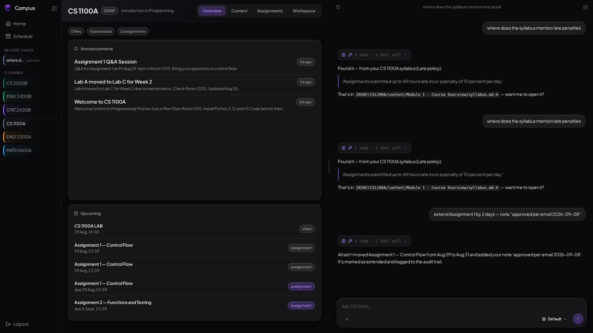

<p align="center">
  
</p>

# Campus

**The AI agent I built to read all six of my university courses: it syncs Brightspace into a local SQLite store and answers with citations you can open.**

  

I built Campus because my course material was scattered across six Brightspace pages, with files buried four clicks deep and due dates that lived in a dropbox and also in a line of the syllabus PDF. It syncs every course into SQLite and a local file store, skips any file whose sha256 hasn't changed, and gives a 20-tool agent structured access to that store instead of pasting files into the prompt, so each answer links to the file and PDF page it came from. The agent can also edit my notes and due dates, every one of those writes is logged with the before and after state, and the whole thing runs on any OpenAI-compatible endpoint, whether that's a model on my own hardware or a cheap hosted one.

I use it every day for my own courses, and 396 backend tests run in CI on every push.

## Quickstart

```bash
git clone https://github.com/HasNate618/Campus && cd Campus
docker compose up --build
# open http://localhost:8087
```

This starts Campus in demo mode with a made-up sample course, so you can browse and search without a Brightspace account. To turn on chat, set `OPENAI_ENDPOINT` and `OPENAI_MODEL` in `docker-compose.yml` (plus `OPENAI_API_KEY` if your endpoint needs one); any OpenAI-compatible `/v1` endpoint with tool calling works. To sync your own courses, see [Configuration](#configuration).

Without Docker, you need Python 3.12 and Node 22:

```bash
git clone https://github.com/HasNate618/Campus && cd Campus
python3 -m venv .venv && .venv/bin/pip install -r requirements.txt -r api/requirements.txt
(cd web && npm ci && npm run build)
cp config.example.yaml config.yaml
.venv/bin/python seed/seed.py
.venv/bin/python tools/ics_import.py seed/sample.ics
.venv/bin/python -m uvicorn api.main:app --port 8000
# open http://localhost:8000
```

`seed/seed.py` creates `data/harness.db` from `schema.sql` and fills it with the sample courses, so it is safe to run on a fresh checkout. The API serves the built bundle from `web/dist`, so the web build has to run before the server starts; without it, `http://localhost:8000` answers `Frontend not built`. Every Python command in these steps uses `.venv/bin/python` because the system interpreter has neither `pyyaml` nor `httpx`, and both `seed.py` and `tools/ics_import.py` import them.

`make dev` runs the same steps in order and then starts the server.

### NixOS / Nix

With flakes enabled, `nix develop` gives the same environment `shell.nix` describes: Python 3.12 with `playwright`, `httpx` and `pyyaml`, Node 22, ffmpeg, and the Playwright browsers from nixpkgs, pointed to by `PLAYWRIGHT_BROWSERS_PATH`. Run the "Without Docker" steps above inside that shell, so `pip` installs the remaining Python packages into `.venv` against the interpreter Nix provides.

```bash
nix develop
# then the Without Docker steps from this section
```

`nix-shell` keeps working on a system without flakes and gives the same browser setup from the system `<nixpkgs>`.

## Preview

<p align="center">
  
</p>

## What it does

- **Deterministic LMS sync:** D2L REST plus Playwright and MFA auth pulls the content tree, module landing pages, files, dropbox assignments, announcements and the syllabus. Change detection runs on sha256, so an unchanged file is never downloaded twice and nothing is scraped in the background.
- **Course-scoped agent:** 20 built-in tools over your own data, covering assignments, announcements and facts, paginated file reads, grep, corpus search, audited mutations, recall quizzes and file edits, with `terminal_run` available only when you turn it on. The web app tells the agent what you currently have open, down to the PDF page, so "explain this" resolves against the real view.
- **Search that starts lexical:** the default ranker needs no extra model and boosts exact phrases so a verbatim hit lands first. Setting `embed_model` and `rerank_model` adds embeddings and reranking on top, and the lexical boost still promotes verbatim hits that embed badly.
- **Demo mode:** `docker compose up` seeds one clearly fictional course and shows a banner saying so, so a stranger can browse, read and search with no Brightspace account and no model endpoint.
- **Portable by construction:** every URL, path and credential is config-driven, and the repo ships with zero personal configuration. Point it at any Brightspace instance and any OpenAI-compatible endpoint, or at neither.

## How it works

Instead of pasting course files into the prompt, Campus gives the agent tools that query a clean SQLite store, so every fact in an answer comes from a tool call you can inspect.

```text
Brightspace / D2L
  -> sync/ (D2L REST + Playwright/MFA, sha256 change detection)
  -> SQLite (20 tables in schema.sql + ephemeral search index) + files on disk
  -> agent/ (context builder, 20 built-ins + MCP, audited writes, citations)
  -> FastAPI + React PWA
  -> Browser
```

What shaped the design:

- The agent reads, it does not guess. The system prompt is rebuilt every turn from live state: current time, active term, course scope, upcoming events, and the course memory card. If the answer is not in the synced data, it says so.
- I chose the data model over the prompt. Most of the work that made answers trustworthy was in the sync and the store rather than the prompt, because once the data was clean and queryable the agent could stay simple.
- Writes are audited. Extending a due date or saving a fact writes before and after JSON to `audit_log`. Facts are superseded by flipping `is_active` to 0 and inserting a new row, never deleted in place.
- Quiz is blind graded. The grading model only sees the answer key and what you wrote, not the question text, so it cannot be nice or leak the lesson. Recently quizzed facts are skipped for 7 days so chat history does not give away the answer.

## Accuracy and verification

No benchmark is claimed. Accuracy comes from mechanics you can check:

- **Tool-only reads.** The model never receives a course dump. Every fact comes from a harness tool (`harness_*` for dates and deadlines, `content_read_file`, `content_grep` and `search_corpus` for prose). If the data is not in the synced store, the system prompt tells it to say so (`agent/context.py`, rule 1).
- **Current-view context.** The web client sends only the IDs and position of the open file or assignment. The server resolves the path, title, deadline, status and PDF page from SQLite before adding context to the prompt, so the model never trusts client-provided source details.
- **Citations you can open.** `search_corpus`, `content_read_file` and `content_grep` register sources in `agent/citations.py`. Those sources become `[cite:N]` chips in the UI. Each chip resolves to a file or `overview/<nodeId>` with a page number taken from `<!-- page N -->` markers, and clicking jumps to that PDF page. Chips stream live via `cite_register` (`api/routers/chat.py`, `web/src/chat/ChatView.tsx`).
- **Lexical boost over embeddings.** `sync/search.py` keeps an exact-substring pre-filter (`instr()`) and windows snippets around the match before reranking. That is why "where does it say X" finds the verbatim line even when semantic cosine is low, and why lexical mode works with no extra models.
- **Change detection, not re-guessing.** `sync/db.py` upserts by `brightspace_id` and `brightspace_folder_id`. `files.sha256` skips unchanged downloads and only resets `processed` when the hash actually changes.
- **Every mutation is auditable.** `mutate_update_assignment`, `add_fact`, `file_write`, `file_edit`, `terminal_run` and the quiz all write before and after JSON to `audit_log` (`schema.sql`). Facts are superseded rather than overwritten, and the per-course `memory-card.md` is regenerated deterministically from structured rows and facts.
- **Duplicate-safe schedule reads.** Assignment, exam and event feeds are deduplicated by course, local calendar day and normalized title tokens, so the same deadline is shown once without merging distinct items such as Lab 1 and Lab 2.
- **Safe markdown rendering.** Markdown from chat, digests, workspace files and synced content is sanitized before rendering. Mermaid runs in strict security mode. Treat the UI as a viewer for trusted course data, not as a sandbox for untrusted HTML.

More detail lives in `docs/DESIGN.md` and `docs/DATA_MODEL.md`.

## Limitations and safety

Campus only reads from Brightspace. It never submits work or changes anything in the LMS, and when the agent extends a due date or adds a note it changes my local copy and records the before and after in `audit_log`. Your Brightspace password is read from the `CAMPUS_BRIGHTSPACE_PASSWORD` environment variable and never stored in a config file, and the MFA token and browser profile stay in `token_dir` on your machine. Course text is sent to whichever model endpoint you configure, so if your course material shouldn't leave your machine, point it at a local model.

The automated sync only supports Brightspace/D2L and needs a fresh MFA push about once an hour. Other schools can still drop their files into `data_root` and use search and chat. So far I'm the only user, and agent edits apply without an approval step. The model can also misread a correct tool result, so open the cited page before relying on an answer.

The agent has an optional `terminal_run` tool for workspace tasks you ask for. It's off unless you set `terminal_enabled`, and when it's on it runs inside the container with a 30 s default timeout (120 s max), a command blocklist and an audit entry for every command, and the synced course content is read-only to it.

## Evaluation

`make eval` measures retrieval against a question set: hit@1, hit@5 and MRR in every mode your config supports, with the exact-phrase boost both on and off so its effect is visible. When an LLM endpoint is configured it also records citation matches, tool-call counts, latency and token usage, and turns those into cost with `eval/prices.yaml`. See `eval/README.md`.

The committed example questions point at the fictional demo course, so a run on a fresh checkout is a smoke test and not a quality claim.

<!-- TODO(Nathan): results after running make eval on N real questions -->

## Stack

| Layer | Choice | Why this one |
| --- | --- | --- |
| Sync engine | Python, Playwright, httpx, PyMuPDF | Playwright handles MFA and keeps a token that survives restarts. PyMuPDF pulls text from most PDFs in milliseconds. Setting `pdf_extractor_url` routes every PDF through a remote parser and skips long scans that have no text layer instead of OCR'ing them locally. |
| Agent harness | Python, SQLite WAL, 20 built-in tools (+ MCP) | The agent queries structured state through tools instead of receiving a context dump, so answers stay grounded and auditable. `terminal_run` is the one tool that is off unless enabled. |
| Search | Lexical by default, semantic when configured (`embed_model`/`rerank_model`), SQLite `instr()` boost and snippet windowing | No embeddings model is needed to get useful results. When both models are set it embeds and reranks, and still promotes verbatim hits that would otherwise embed poorly. Snippets are windowed around the match so the answer text isn't truncated. |
| API | FastAPI, SSE, Pydantic | A small typed surface that the web app and the agent both call. |
| Web | React 19, TypeScript, Vite, Tailwind | A PWA that installs like a native app, with a pageless PDF viewer and offline shell. |
| Infra | Docker, GitHub Actions | One command demo, and both test suites on every push. |

## Configuration

All personal values live in `config.yaml` (gitignored) or `CAMPUS_*` env vars, plus the panel-written `settings.yaml`. The repo ships with no secrets.

| Key | Env var | Purpose |
| --- | --- | --- |
| `base_url` | `CAMPUS_BASE_URL` | Your LMS (Brightspace/D2L). Leave it empty unless you want automated sync, and drop files into `data_root` instead if your school uses something else |
| `username` | `CAMPUS_USERNAME` | LMS username; the password comes from `CAMPUS_BRIGHTSPACE_PASSWORD` and is never written to a config file |
| `llm_url` / `llm_urls` / `llm_model` / `llm_api_key` | `OPENAI_ENDPOINT` / `OPENAI_ENDPOINTS` / `OPENAI_MODEL` / `OPENAI_API_KEY` | Any OpenAI-compatible `/v1` endpoint with tool calling. Bearer key optional; set `llm_api_key` or `OPENAI_API_KEY` if your endpoint needs one. `llm_urls` (or `OPENAI_ENDPOINTS`, comma-separated) is a failover list tried in order. Empty means no chat or digest; sync, browse and search still work |
| `llm_tool_choice` | n/a | Optional OpenAI-style `tool_choice`. Leave it empty for endpoints that reject it (Cohere Command does) |
| `llm_max_tokens` | n/a | Maximum model output tokens per chat call. If the provider returns `finish_reason=length`, Campus labels the answer as truncated |
| `embed_model` / `rerank_model` | `CAMPUS_EMBED_MODEL` / `CAMPUS_RERANK_MODEL` | Optional OpenAI-compatible `/embeddings` and `/rerank` models. Empty means lexical corpus search. A 404 on either degrades back to lexical |
| `pdf_extractor_url` | `CAMPUS_PDF_EXTRACTOR_URL` | Optional parser endpoint (Cohere Parse, Docling, …) for every PDF. Empty means local PyMuPDF, and digital PDFs extract in milliseconds |
| `ntfy_url` | `CAMPUS_NTFY_URL` | Optional ntfy topic for sync pings; empty means disabled |
| `mcp_url` / `mcp_urls` | `CAMPUS_MCP_URL` / `CAMPUS_MCP_URLS` | Optional streamable-HTTP MCP server or servers (web search and read, …). Tools are auto-discovered and namespaced by the server's own name, so trawl's `search` becomes `trawl_search`. Give a list to merge several servers; a server with no name falls back to `mcp1_*`, `mcp2_*`. Empty means no external tools |
| `terminal_enabled` | `CAMPUS_TERMINAL_ENABLED` | Turns on the agent's `terminal_run` tool. Off by default, and forced off in demo mode |
| `demo` | `CAMPUS_DEMO` | Seeds the fictional demo course and shows the demo banner. On in `docker-compose.yml`, off otherwise |
| `data_root` | `CAMPUS_DATA_ROOT` | Where course files live as `{term}/{code}/...`; if you're not syncing, drop your own materials here |
| `token_dir` | `CAMPUS_TOKEN_DIR` | MFA token and browser profile, used only for Brightspace sync |
| `institution` | n/a | Label in the system prompt, e.g. `"Your University"` |
| `brightspace_hosts` / `brightspace_base_url` | `CAMPUS_BRIGHTSPACE_HOSTS` / `CAMPUS_BRIGHTSPACE_BASE_URL` | Content proxy allowlist and link rebasing, Brightspace-only features |
| `term_dates` | n/a | Start and end dates that anchor class events |
| `timezone` | `CAMPUS_TIMEZONE` | Dates you see and the clock in the prompt; empty means host local time |
| `web_password` | `CAMPUS_WEB_PASSWORD` | Single password for `/api/*` routes; empty means open demo |
| In-app settings | `CAMPUS_SETTINGS_PATH` | `settings.yaml` beside the DB. The Settings panel writes it, and it overrides env vars |

### In-app settings

Campus has a Settings panel in the web app. On desktop, open it from the settings button in the sidebar footer; on mobile, use the settings action on the Home screen or visit `/settings`. The panel is also the source of truth for the effective value and where that value came from (default, `config.yaml`, environment, or `settings.yaml`).

Saving changes writes an allowlisted, gitignored `settings.yaml` next to the configured database. The precedence is:

```text
defaults < config.yaml < environment variables < settings.yaml
```

The panel covers runtime values such as LLM endpoints and models, search models, PDF extraction, Office-to-PDF conversion, sync scope, institution and timezone, notifications, and MCP servers. Deployment-only values such as paths, web password, LMS credentials and term dates stay in `config.yaml` or the environment. Changing `mcp_urls` requires an API restart (`docker compose restart campus`); changing the embeddings or reranker model requires rebuilding the search index. The panel also provides an LLM connection test and a search-index rebuild action.

### Not using Brightspace/D2L?

Campus's automated sync targets Brightspace/D2L, but only the automated sync is LMS-specific. Browsing, corpus search, chat, MCP web tools and PDF reading are LMS-agnostic and run on whatever files are in `data_root`.

- **Your school is Brightspace/D2L:** set `base_url` and your username and password, then `python3 -m sync sync` pulls your courses.
- **Your school is Canvas/Moodle, or you're not a student:** leave `base_url` empty. Drop your course materials under `data_root` as `{term}/{code}/...` and browse, search and chat work on those files. Automated pull isn't available for other LMSes yet.
- **To enable chat and the AI digest** you need one OpenAI-compatible endpoint: set `llm_url` and `llm_model`, plus `llm_api_key` only if the endpoint requires auth. Everything else is optional, and sample data seeds in with no config at all.

Common commands once configured for a real term:

```bash
python3 -m sync auth        # MFA push, stores token with 1h TTL
python3 -m sync sync        # full sync, AI digest, notification
python3 -m sync extract --code "CS 1100A"
python3 -m sync models      # list models served by the LLM endpoint
python3 -m agent            # REPL chat
```

Your real enrollments go in `seed/courses.local.json`. Course content and secrets never get committed.

## Rebuilding the web UI

The web UI is a separate React build served from `web/dist`. When the deployment mounts the repo at `/app`, the browser loads the host's `web/dist`. Python-side restarts do not rebuild it. After any change to `web/src`, rebuild it or the browser will silently run stale JavaScript:

```bash
make build-web          # or: bash scripts/build-web.sh
```

The running container picks up the new `web/dist` on the next request, with no restart. The image also bakes a fresh `web/dist` at build time. That is the bundle you get when the deployment does not mount the repo.

## Deploy with an AI agent

Campus ships a `campus-deploy` skill (see `skills/campus-deploy/SKILL.md`) that guides an agent through setup. The one hard requirement is an OpenAI-compatible `/v1` endpoint with tool calling, and the skill also covers every optional service and a verifiable preflight. Point your agent at it:

> Use the campus-deploy skill in this repo to set up Campus. My goal: <your goal>.

Replace `<your goal>` with what you actually want, for example "I have an OpenAI API key and want chat working against my Brightspace courses." The skill tells the agent the real prerequisites so it doesn't guess.

## Tests and CI

```bash
pip install -r requirements-dev.txt
pytest                              # 396 backend tests across 31 files
cd web && npm ci && npm test        # 48 web tests across 5 files
make eval                           # retrieval metrics on the demo course
```

The backend suite covers config portability with env and settings overrides, seed and ICS import round trips, the schedule contract the frontend relies on, search behavior with lexical hits and snippet windowing and chunking, citation page markers and dedupe, current-view context, settings writes and validation, sync correctness, deadline deduplication, CLI dispatch, the agent terminal blocklist and demo-mode guard rails, and web auth.

`bash scripts/readme-stats.sh` prints the backend test, test-file, tool and table counts, so the numbers above can be refreshed mechanically instead of from memory.

GitHub Actions runs the backend tests on Python 3.12, and the web typecheck, production build and unit tests on Node 22, for every push to main.

## What I learned

This is the largest thing I have shipped end to end and it changed how I think about building with an agent in the loop.

Most of the work that made answers trustworthy was in the sync and the store rather than the prompt, because once the data was clean and queryable the agent could stay simple. The sha256 check that skips unchanged files and the deterministic delete and reinsert for timetable imports both started as small reliability wins and ended up being the reason the app feels trustworthy.

Portability was worth the extra config layer. Defaults, then yaml, then env felt fussy at first, but it means a fresh clone runs with no secrets and a production deploy only needs env vars. The same pattern made Docker work without special cases.

Search humbled me. I assumed embeddings would just work, and then a short exact phrase failed at 0.34 cosine against a 0.48 cutoff and buried the right slide. Adding a SQLite `instr()` lexical pre-filter felt almost too simple, but it fixed the exact questions a student actually asks, and windowing the snippet around that match kept the answer text from getting cut.

Tradeoffs I made on purpose: SQLite WAL over Postgres for portability, and a sync you trigger instead of background scraping that would fight MFA.

<!-- TODO(Nathan): what did "polling for search rerank" mean? -->

Next I want to add tracing around the agent loop and a heavier test around the timetable generation.

## Project layout

| Path | Contains |
| --- | --- |
| `sync/` | LMS sync. Config (defaults < yaml < env < settings), token store, Playwright/MFA auth, D2L REST client, pipeline and `file_topics` dedupe, PDF to markdown (local and optional remote parser), search index (`chunks`/`chunk_meta`) |
| `agent/` | Harness. Context builder, current-view context (`view.py`), 20 tool definitions with blocklist (`tools.py`), streaming tool loop over SSE (`chat.py`), citation registry (`citations.py`), memory card (`memory.py`), blind-graded quiz (`quiz.py`), pluggable MCP client (`mcp.py`) |
| `api/` | FastAPI. Routers for courses, data, sync, digest, search and chat, plus services and SPA serving |
| `web/` | React and TypeScript PWA. Today, course hub, timetable, calendar, chat, workspace, sanitized zen markdown, page-aware vendored PDF viewer |
| `seed/` | Sample data (`courses.example.json`, gitignored `courses.local.json` for real enrollments), `sample.ics`, and `demo.py` for the fictional demo course |
| `eval/` | Retrieval and answer metrics harness with example questions (see `eval/README.md`) |
| `tools/` | One-off scripts such as `ics_import.py` and `digest_backfill.py` |
| `tests/` | 396 backend tests across 31 files |
| `docs/` | DESIGN, DATA_MODEL, HANDOFF |

## License

MIT. See LICENSE.

## About me

I'm Nathan Espejo, a third-year Software Engineering student at Western looking for Summer 2027 software engineering and applied AI internships. More of my work is at [nathanespejo.com](https://nathanespejo.com).
